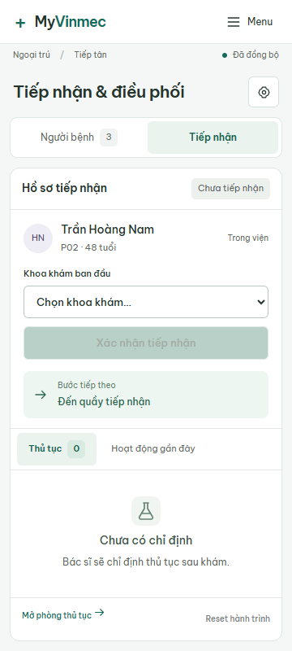
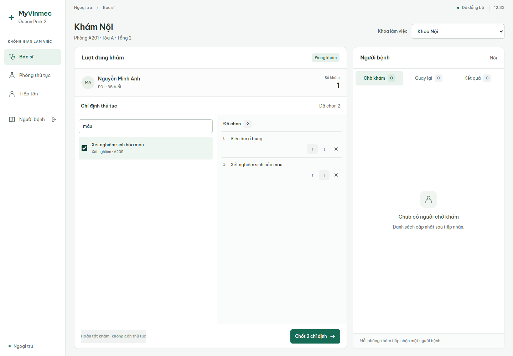
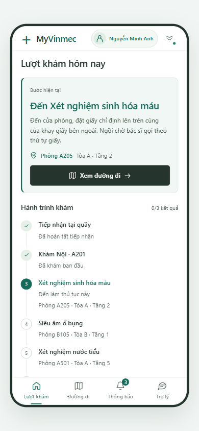
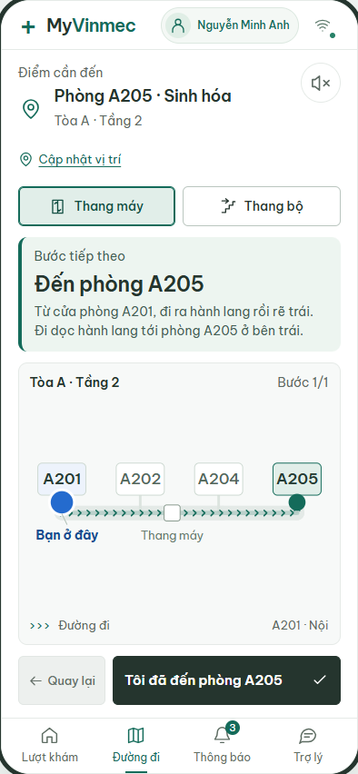
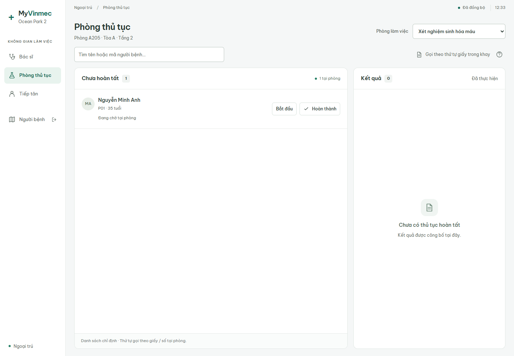
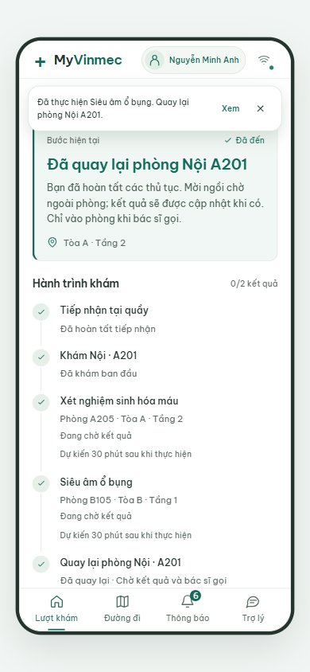
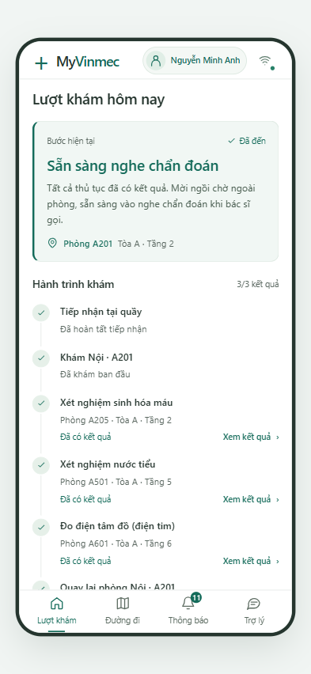

# Luồng hệ thống qua ảnh

[← README dự án](../README.md) · [Hướng dẫn chạy prototype](../05-prototype/README.md)

Xem các màn dưới đây theo thứ tự để hiểu một lượt khám mà **không cần cài đặt, khởi động server hoặc cơ sở dữ liệu**. Ảnh được nhúng trực tiếp từ repo; bấm vào ảnh để xem kích thước gốc.

Đây là ảnh chụp ứng dụng trong các kịch bản kiểm thử với hồ sơ, phòng và sơ đồ mô phỏng. Các ảnh minh họa từng bước được chọn từ nhiều kịch bản, nên tên người bệnh, số lượng và danh sách thủ tục có thể khác nhau giữa các bước.

## Toàn bộ luồng

**Tiếp nhận → khám ban đầu và chỉ định → xem bước tiếp theo → đi đến phòng → thực hiện thủ tục → quay lại khoa → chờ đủ kết quả và bác sĩ gọi.**

| Bước | Ai thao tác / giao diện | Thay đổi người đọc cần theo dõi |
| --- | --- | --- |
| [1. Tiếp nhận](#buoc-1) | Lễ tân | Chọn khoa khám ban đầu, gắn phòng khám và số khám với lượt khám. |
| [2. Chỉ định](#buoc-2) | Bác sĩ | Chọn và chốt các thủ tục; các phòng thủ tục nhận được danh sách công việc. |
| [3. Việc tiếp theo](#buoc-3) | Người bệnh — Lượt khám | Thấy phòng cần đến, việc cần làm và tiến độ toàn lượt. |
| [4. Dẫn đường](#buoc-4) | Người bệnh — Đường đi | Xem tuyến, chọn loại thang và xác nhận đã tới mốc / phòng. |
| [5. Thực hiện](#buoc-5) | Nhân viên phòng thủ tục | Ghi nhận đến phòng, bắt đầu, hoàn tất; công bố kết quả riêng. |
| [6. Quay lại khoa](#buoc-6) | Người bệnh và bác sĩ | Hoàn tất mọi thủ tục thì có đường về khoa ban đầu và cập nhật danh sách quay lại. |
| [7. Đủ kết quả](#buoc-7) | Phòng thủ tục, người bệnh và bác sĩ | Khi đã công bố đủ kết quả, người bệnh nhận hướng dẫn chờ bác sĩ gọi. |

**Hoàn tất thủ tục và có kết quả là hai mốc riêng.** Người bệnh có thể đã quay lại khoa trong khi kết quả vẫn đang chờ; phần cuối minh họa cả hai trạng thái này.

## 1. Lễ tân tiếp nhận và chọn khoa

Nhân viên chọn hồ sơ, chọn **Khoa khám ban đầu**, rồi bấm **Xác nhận tiếp nhận**. Hệ thống gắn khoa, phòng và số khám; màn người bệnh chuyển sang hướng dẫn đến phòng khám ban đầu.

Ảnh dưới là màn tiếp nhận trên điện thoại, trước khi chọn khoa. Nút xác nhận chưa bật vì chưa đủ thông tin.

[Xem giao diện tiếp nhận trên máy tính và phần theo dõi tiến độ](bo-sung/nhan-vien/reception-desktop.png).

## 2. Bác sĩ khám ban đầu và chốt chỉ định

Bác sĩ gọi người bệnh, bắt đầu trao đổi, tìm thủ tục và đưa vào danh sách đã chọn. Trong ảnh, bác sĩ khoa Nội đang chọn **Siêu âm ổ bụng** và **Xét nghiệm sinh hóa máu**.

Khi bấm **Chốt 2 chỉ định**, các thủ tục mới được đưa vào hành trình người bệnh và danh sách công việc tại phòng thủ tục. Danh sách đang chọn của bác sĩ chưa phải chỉ định đã chốt.

## 3. Người bệnh biết việc cần làm tiếp theo

Tab **Lượt khám** đặt bước hiện tại ở đầu: đến đâu, phòng nào và làm gì khi tới. Bên dưới là hành trình gồm các bước đã xong và các thủ tục còn lại. Nút **Xem đường đi** mở hướng dẫn đến phòng đang được đề xuất.

Ảnh này dùng kịch bản ba thủ tục. Hệ thống đề xuất đến **Sinh hóa máu A205** trước; thứ tự dự kiến ưu tiên phòng ít người đang chờ / thực hiện, rồi xét khoảng cách. Danh sách chỉ định của bác sĩ được giữ nguyên.

[Quy tắc điều phối và ví dụ trước / sau khi hoàn tất thủ tục](../05-prototype/adaptive-routing.md).

## 4. Đi đến phòng bằng bản đồ và chỉ dẫn từng chặng

Tab **Đường đi** hiển thị phòng đích, chỉ dẫn bằng chữ, bản đồ và nút xác nhận bước hiện tại. Chấm xanh dương là vị trí đã xác nhận; tuyến xanh dẫn đến phòng cần tới. Có lựa chọn **Thang máy / Thang bộ** và nút loa cho hướng dẫn bằng giọng đọc.

Trong ảnh, người bệnh đi từ **Nội A201 đến Sinh hóa A205** trên cùng tầng. Bấm **Tôi đã đến phòng A205** để ghi nhận đã tới. Vị trí dựa trên xác nhận của người dùng, chưa có định vị trong nhà tự động.

Điểm đến được giữ ổn định trong lúc di chuyển. Sau mỗi thủ tục hoàn tất, hệ thống tính tiếp phòng nên đến và cập nhật hướng dẫn.

## 5. Phòng thủ tục ghi nhận và hoàn tất công việc

Nhân viên chọn phòng đang làm việc, xem người có chỉ định và ghi nhận **Đã đến phòng → Bắt đầu thực hiện → Đã hoàn thành**. Cách này hỗ trợ cả người cầm giấy không mở ứng dụng.

Ảnh dưới cho thấy một người đang chờ tại phòng Sinh hóa A205. Danh sách công việc không phải thứ tự gọi; trong kịch bản này nhân viên gọi theo thứ tự giấy trong khay.

Hoàn tất thực hiện cập nhật tiến độ trên các màn và hướng dẫn đến thủ tục tiếp theo. **Công bố kết quả** là thao tác riêng trong vùng Kết quả; chế độ bản giấy có thêm xác nhận giao giấy.

[Xem màn sau khi hoàn tất nhưng đang chờ kết quả](bo-sung/nhan-vien/procedure-desktop.png) · [Xem trạng thái đã có kết quả và đã giao bản giấy](bo-sung/nhan-vien/procedure-mobile.png).

## 6. Hoàn tất thủ tục và quay lại khoa ban đầu

Khi tất cả thủ tục đã thực hiện xong, hệ thống dẫn người bệnh về khoa ban đầu và đưa lượt khám vào danh sách **Quay lại** của bác sĩ. Người bệnh xác nhận đã tới phòng và chờ bên ngoài.

Ảnh dưới cho thấy đã quay lại **Nội A201**, nhưng **0/2 kết quả**: thực hiện xong chưa có nghĩa là các kết quả đã được công bố.

## 7. Đủ kết quả, sẵn sàng chờ bác sĩ gọi

Mỗi lần phòng thủ tục công bố kết quả, người bệnh và bác sĩ nhận cập nhật. Khi đã có đủ kết quả, hệ thống gửi thông báo tổng hợp. Nếu người bệnh đã ở khoa ban đầu, bước hiện tại chuyển thành **Sẵn sàng nghe chẩn đoán**.

Ảnh dưới minh họa kịch bản đã có **3/3 kết quả**. Người bệnh có thể mở từng kết quả và chờ bác sĩ gọi; prototype không tự diễn giải chẩn đoán y khoa.

[Xem tab Thông báo khi có kết quả và hướng dẫn quay lại khoa](bo-sung/tab-nguoi-benh/inbox-390.png).

## Các tình huống hỗ trợ

| Tình huống | Cách hệ thống hỗ trợ | Ảnh / tài liệu để xem |
| --- | --- | --- |
| Đi lạc hoặc quay lại viện | Người bệnh chọn tòa, tầng và mốc đang đứng; xác nhận để tính lại đường, giữ tiến độ và điểm đến. | [Hộp cập nhật vị trí](bo-sung/vi-tri-ket-noi/choose-location.png), [tuyến tính lại từ tòa B](bo-sung/vi-tri-ket-noi/rerouted-from-building-b.png) |
| Mất kết nối | Hiện cảnh báo, giữ mốc đồng bộ cuối, khóa xác nhận và có nút kết nối lại. | [Màn cảnh báo mất kết nối](bo-sung/vi-tri-ket-noi/offline-warning.png) |
| Dùng giấy dự phòng | In hoặc lưu hướng dẫn trước; nhân viên ghi nhận tiến độ tại phòng. Giấy đã lưu không tự cập nhật. | [Giấy hướng dẫn mẫu PDF](tai-lieu/giay-huong-dan.pdf) |
| Muốn hỏi thêm về lượt khám | Tab Trợ lý hỗ trợ câu hỏi hành chính theo dữ kiện lượt khám. Ảnh hội thoại được tạo trong kiểm thử bằng phản hồi mô phỏng. | [Màn hội thoại](bo-sung/tab-nguoi-benh/chat-conversation-390.png), [phạm vi trợ lý](../05-prototype/assistant-context.md) |

## Nguồn ảnh và cập nhật

Toàn bộ ảnh giao diện được gom trong thư mục này, với một nơi lưu cho mỗi tệp:

| Thư mục | Nội dung |
| --- | --- |
| [`anh/`](anh/) | 7 ảnh chính, đánh số từ 01 đến 07 theo luồng ở trên. |
| [`bo-sung/`](bo-sung/README.md) | Các màn bổ sung và biến thể màn hình, nhóm theo chức năng. |
| [`luu-tru/`](luu-tru/README.md) | Ảnh các đợt thiết kế trước và sơ đồ cũ để đối chiếu. |
| [`tai-lieu/`](tai-lieu/) | Giấy hướng dẫn dự phòng dạng PDF. |

Ảnh chụp giao diện do Playwright tạo; bộ sơ đồ cũ có nguồn riêng trong báo cáo bản đồ. [Danh mục đường dẫn](danh-muc-anh.json) ghi nơi cũ và nơi mới của từng tệp để đối chiếu báo cáo lịch sử.

| Nhóm ảnh | Kịch bản tạo ảnh |
| --- | --- |
| Tiếp nhận, bố cục phòng thủ tục và bản giấy | [`staff-workspace.spec.ts`](../05-prototype/tests/e2e/staff-workspace.spec.ts) |
| Chỉ định, đến phòng thủ tục, quay lại khoa và giấy dự phòng | [`sequential-journey.spec.ts`](../05-prototype/tests/e2e/sequential-journey.spec.ts) |
| Thứ tự thủ tục dự kiến | [`adaptive-routing.spec.ts`](../05-prototype/tests/e2e/adaptive-routing.spec.ts) |
| Bản đồ, cập nhật vị trí và mất kết nối | [`navigation-recovery.spec.ts`](../05-prototype/tests/e2e/navigation-recovery.spec.ts) |
| Đủ kết quả, thông báo và hội thoại | [`patient-tabs-chat.spec.ts`](../05-prototype/tests/e2e/patient-tabs-chat.spec.ts) |

Bộ kiểm thử đã được cập nhật để ghi ảnh trực tiếp vào thư mục này qua `05-prototype/tests/e2e/ui-artifacts.ts`, không tạo lại bộ ảnh rải rác trong `outputs/`. Người bảo trì có thể tạo lại ảnh bằng bộ kiểm thử theo [hướng dẫn phát triển](../05-prototype/README.md#kiểm-tra-và-phát-triển). Người đọc chỉ cần mở trang này. Phạm vi đã kiểm tra và các hạn chế được ghi trong [báo cáo kiểm thử](../05-prototype/test-report.md).
