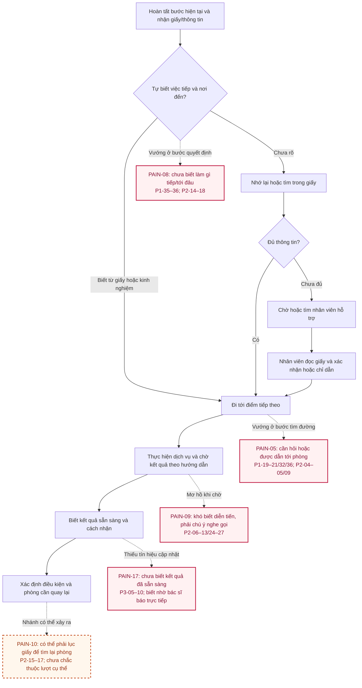
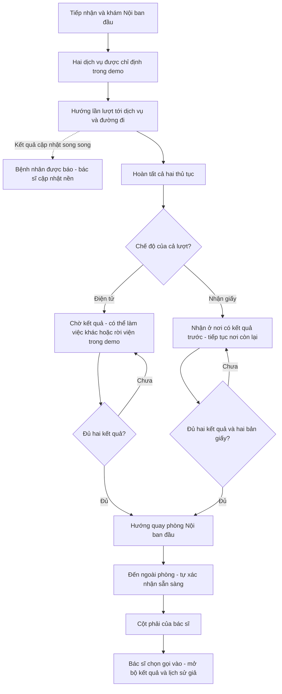

# Journey map - P1/P2 và P3 tự thuật

Bản phân tích 18/10/2026, từ [P1](../01-phong-van/P1.md), [P2](../01-phong-van/P2.md). P1/P2 giữ hai hành trình riêng; P3 tự thuật bổ sung ở cuối; không ghép thành một “người dùng điển hình”. Chỉ gán cảm xúc khi nguồn có diễn giải tương ứng; chỗ chưa ghi là **chưa ghi**, không tự chấm điểm. Mọi dòng là dữ liệu thuật lại, chưa quan sát tại viện.

**Cách đọc điểm đau, cập nhật 19/10:** mỗi journey đã có cột Pain gắn mã PAIN và nguồn theo từng bước. Workflow hiện trạng bên dưới bổ sung nhãn mô tả và màu để nhìn thấy ngay điểm đau. Nhãn hồng là vướng mắc được thuật lại; nhãn cam nét đứt là nhánh có điều kiện/chưa xác định xảy ra trong lượt cụ thể. Màu không phải điểm severity hoặc tần suất. Workflow prototype ở cuối là giải pháp đề xuất, tách khỏi bằng chứng hiện trạng.

## P1 - Vinmec, web → app → cơ sở gần hơn

| Bước | Mục tiêu / hành động | Điểm chạm / thông tin | Cảm xúc được ghi lại | Pain | Nguồn |
| --- | --- | --- | --- | --- | --- |
| 1. Đặt web | Chọn cơ sở/khoa/bác sĩ/8h, nhập form, xác nhận | Web không đăng nhập, phí dự kiến; SMS/email có thông tin cơ bản | Chưa ghi | PAIN-01 khi cần xem lại | P1-01-06 |
| 2. Xem lại | Không nhớ hết lựa chọn, tìm chi tiết | Web không tìm được đường xem lại; tin chưa đủ bác sĩ/khoa | Muốn kiểm tra lại | PAIN-01 | P1-07 |
| 3. Chuyển app | Tạo tài khoản cùng email, tìm lịch/PID, hỏi bot | Lịch web không thấy, tìm ở đặt lịch/hồ sơ; bot không giải đáp theo ghi chú | Bất lực theo ghi chú | PAIN-02/03 | P1-08-13 |
| 4. Đặt gần hơn | Đặt qua app ở cơ sở khác, điền form | Có mục lịch và nhắc trong app; không SMS/email theo ghi chú | Chưa ghi | Không coi đây tự thân là thất bại | P1-14-16 |
| 5. Hủy lịch cũ | Google số, chưa gọi tối vì nghĩ muộn | Nhiều hotline; cần kênh con người | Lo không biết hủy ở đâu | PAIN-04 | P1-17-18 |
| 6. Tới nơi | 7h40 cho lịch 8h; hỏi tầng 1 hai việc | Đưa lịch app; được hướng tầng 2 và hotline | Chưa ghi | PAIN-05 | P1-19-21 |
| 7. Gọi hủy | Trước 8h bận; khoảng 8h10 gọi lại | Người nhận gọi xác nhận hủy bằng lời | Không tự suy nhẹ nhõm | PAIN-04; có kết quả khôi phục | P1-22-24, CONF-07 |
| 8. Chờ tiếp nhận | Đợi người khác hỗ trợ, khoảng 10 phút ước lượng; kể lại | Bàn giao NV1 → người hỗ trợ, không rõ khi nào | “Vô vọng” trong ghi chú | PAIN-06 | P1-25-27, CONF-06 |
| 9. Làm hồ sơ | Hỏi lại, nhân viên nhập máy; nhận bao giấy/hai phiếu nhỏ | Giải thích chưa có hồ sơ lần đầu, giấy có phòng | Đặt app có ích gì; vô nghĩa | PAIN-07 | P1-28-31 |
| 10. Tới phòng đầu | Người điều phối chủ động dẫn | Con người + hồ sơ | Chưa ghi; đây là điểm hỗ trợ tốt | PAIN-05 là nhu cầu được hỗ trợ | P1-32/34 |
| 11. Sau phòng đầu | Nhận giấy, chưa biết bước tiếp; chờ/tìm người | Điều phối xem giấy rồi chỉ/dẫn | Mơ hồ theo nội dung ghi chú | **PAIN-08** | P1-35-36 |
| 12. Kết thúc phần dịch vụ | Nhận giấy in/nhắc nhở; tự quay thanh toán | Dựa kinh nghiệm, không tự kết luận không có lời hướng dẫn | Chưa ghi | PAIN-08/13 | P1-37-39 |
| 13. Thanh toán | Mới biết điều kiện ưu đãi/app khác; trả giá thường; tổng cao hơn dự tính | Quầy thanh toán; chưa có phân rã phí | Băn khoăn về ước tính/chi phí | PAIN-11/12 | P1-40-43 |
| 14. Nhận thuốc/kết thúc | Hỏi điểm nhận, xuống tầng 1; đưa giấy, không xếp hàng; trả khoản này rồi về | Nhân viên quầy trả lời, quầy thuốc báo tiền/hóa đơn | Biết đã xong; không gán cảm xúc thêm | PAIN-13 có hỗ trợ, không có chờ kéo dài | P1-44-48 |

Hủy lịch và làm thủ tục có thể xen nhau; nguồn không cho phép xác định chính xác toàn bộ thứ tự theo phút. Không cộng 7h40, 8h10 và khoảng 10 phút thành tổng chờ. Thử đặt lịch mới 1-2 ngày sau là quan sát ở thời điểm khác, không chèn như bước trong lượt khám (P1-20/CONF-08).

## P2 - cơ sở khác, tới trực tiếp; có nhánh hồi tưởng/giả định

| Bước | Hành động / kênh | Cảm xúc hoặc nhu cầu được ghi | Pain | Nguồn / mức chắc chắn |
| --- | --- | --- | --- | --- |
| 1. Tiếp nhận | Bấm số, nghe loa số, tới quầy; giấy nhận diện; hướng khoa | Xếp khâu chờ số là lâu | PAIN-09 | P2-01-03/24; chưa đo |
| 2. Tìm phòng | Giấy có phòng; suy tầng, tự đi; hỏi khi không biết | Chưa ghi cảm xúc cụ thể | PAIN-05 | P2-04-05; “302” là ví dụ chưa phân định |
| 3. Chờ khám | Gõ cửa/nộp giấy; chờ gọi tên, tập trung nghe; có thể được ra tìm | Phải chú ý để không bỏ lỡ | PAIN-09 | P2-06-07; không chứng minh đã lỡ |
| 4. Chuyển điểm dịch vụ | Nhận giấy chỉ phòng, tự tìm, nộp và đợi | “Vô vọng” theo ghi chú | PAIN-05/08/09 | P2-08-10 |
| 5. Chờ/nhận kết quả | Thời điểm nói miệng; chờ/làm bước khác/về tùy điều kiện; gọi tên/năm sinh để nhận | Muốn chủ động thời gian | PAIN-09 | P2-11-13/24-27; 30-60 phút không là số đo |
| 6. Quay phòng đầu | Nhớ phòng; khi nhiều giấy có thể lục tờ đầu hoặc nhờ người | Muốn đỡ tự khôi phục thông tin | **PAIN-08/10** | P2-14-18; 9 tờ là minh họa |
| 7. Thanh toán | Gom giấy, hỏi nếu cần; quầy cạnh tiếp nhận, xếp giấy/chờ mic gọi tên | Chưa ghi | PAIN-09/13 | P2-19-20 |
| 8. Nhận thuốc | Tìm quầy, có thể hỏi nhân viên/bảo vệ; tìm đúng tờ giữa nhiều giấy | Chưa ghi cảm xúc cụ thể | PAIN-10/13 | P2-21-22; có nhánh “nếu” |
| 9. Sau lượt / hẹn tiếp | Áng chừng, ít ghi, giấy/sổ phải đọc lại; đề xuất nhắc/Calendar | Khó nhớ, ngại ghi, cần sắp lịch việc | PAIN-14 | P2-28-34; cố định/có điều kiện chưa rõ |
| 10. Truy lại lịch sử | Mang sổ và giấy gần nhất, chữ khó đọc; muốn gom thông tin | Lo thất lạc là nguy cơ được nêu | PAIN-10/15 | P2-35-39; không có vụ mất giấy được xác minh |

## Workflow hiện trạng tổng hợp - các điểm đau liên quan hướng prototype

Từ việc xác định bước/điểm đến sau một phòng tới chờ/nhận kết quả và quay lại. Đây là sơ đồ tổng hợp các điểm bàn giao từ P1/P2/P3, không phải một người đi qua mọi bước hoặc gặp mọi điểm đau. Nhánh nhận giấy phụ thuộc bối cảnh nguồn; không áp vào mọi cơ sở.

Các ô PAIN là chú thích bằng chứng, không phải các bước bắt buộc hoặc sự cố đã kiểm chứng độc lập. P1 có điều phối chủ động hỗ trợ; P2 nhớ được phòng đầu; P3 đã biết nơi quay lại và được bác sĩ mời vào. Không suy ra mọi người đi sai, lỡ lượt hoặc chờ thừa. P2 có cả lời kể và ví dụ có điều kiện; xem giới hạn ở journey/nguồn.

**Đối chiếu điểm đau với phần sẽ kiểm tra trong prototype**

| Điểm đau | Nguồn | Phần thiết kế đề xuất | Điều quan sát khi thử, chưa có kết quả |
| --- | --- | --- | --- |
| PAIN-08: chưa xác định được bước tiếp/điểm đến | P1-34–38; P2-14–18 | Thẻ việc cần làm bây giờ, tiến độ và điều kiện quay lại | Chọn đúng đi tiếp/chờ/quay lại và nêu được lý do |
| PAIN-05: cần hỗ trợ tìm phòng | P1-19–21/32/36; P2-04–05/09 | Tòa/tầng/phòng, điểm xuất phát và đường đi theo mốc | Tìm đúng điểm đến/tuyến trên sơ đồ giả |
| PAIN-09: thiếu thông tin diễn tiến khi chờ | P2-06–13/24–27 | Trạng thái từng việc/kết quả, dự kiến có nguồn, thông báo lưu lại | Hiểu đang chờ gì và việc nào còn có thể làm |
| PAIN-17: chưa nhận tín hiệu khi kết quả sẵn sàng | P3-05–13, tự thuật | Cập nhật theo xác nhận dịch vụ và hướng dẫn hành động tương ứng | Nhận ra cập nhật, không nhầm với lời mời vào phòng |
| PAIN-10: gánh khôi phục thông tin từ giấy | P2-15–17/22/35–38, có nhánh điều kiện | Giữ ngữ cảnh phòng đầu và tình trạng nhận giấy; vẫn có giấy dự phòng | Quay đúng phòng/nhận đúng giấy, tìm được hỗ trợ khi app lỗi |

Không có mã pain nghiên cứu riêng đã xác thực cho giao diện bác sĩ hai cột hoặc nút sẵn sàng. Đó là các quyết định mô phỏng người làm bài cung cấp để phối hợp tiếp nhận; cần thử như giả thuyết thiết kế, không gán thành phát hiện phỏng vấn.

## P3 - tự thuật ở cơ sở khác

| Bước | Hành động/tín hiệu | Cảm nhận/nhu cầu từ lời kể | Pain | Nguồn |
| --- | --- | --- | --- | --- |
| 1. Bắt đầu tại viện | Chưa biết cách lấy số, đi tìm và hỏi | Muốn biết phải bắt đầu ở đâu; không tự gán mức cảm xúc | PAIN-16 | P3-02-03 |
| 2. Từ khám đầu sang các điểm dịch vụ | Làm theo hướng dẫn ban đầu | Chưa mô tả cảm xúc | Không tự chép các nhánh P2 | P3-04 |
| 3. Được hẹn nhận kết quả | Được hướng quay phòng đầu, khoảng 2 giờ | Có đích và mốc dự kiến | Không phải không biết phòng | P3-05 |
| 4. Chờ ngoài phòng | Quay về ngồi đợi, chưa có tín hiệu cập nhật | Chưa biết có thể tiếp tục lúc nào | PAIN-17/09 | P3-06/10 |
| 5. Được thông báo trực tiếp | Khoảng 1 giờ sau bác sĩ đi ra, gặp và báo có kết quả, mời vào | Biết việc tiếp nhờ lời mời trực tiếp | Có điểm khôi phục hữu ích | P3-07-09 |
| 6. Nhìn lại | Muốn thông báo kịp thời và hướng việc tiếp để chủ động thời gian | Lợi ích là mong muốn, chưa thử | Chưa định lượng chờ có thể tránh | P3-11-13 |

Hướng hiện hành theo người làm bài làm rõ ngày 18/10 là **hướng dẫn chuyển bước trong phần khám tại viện**, gồm việc tiếp theo, vị trí, cách đi và cập nhật kết quả song song. P3 làm rõ tín hiệu thời điểm, không thay thế nhu cầu vị trí của P1/P2. Journey nguồn ở trên được giữ đúng lời kể; workflow dưới đây là thiết kế đề xuất, chưa thử và không phải quy trình Vinmec đã xác minh.

**Workflow prototype cập nhật 19/10: hai chế độ cho cả lượt**

Bối cảnh do người làm bài chọn: Vinmec ở Vinhomes Ocean Park 2, Nội; Siêu âm ổ bụng và Xét nghiệm sinh hóa máu. Thử cả hai chế độ, không trộn theo từng dịch vụ trong bản này. Nơi làm trước có kết quả trước theo kịch bản. Cột trái bác sĩ dành cho khám lần đầu, cột phải chỉ nhận người đã tự xác nhận sẵn sàng ngoài phòng; đủ kết quả chưa tự vào cột phải.

Giấy hướng dẫn giữ ở cả hai chế độ; app lỗi thì tiếp tục bằng giấy và nhân viên hỗ trợ. Sơ đồ/phòng/tầng là giả, nút sẵn sàng chưa xác thực vị trí. Đây là workflow thiết kế từ yêu cầu ngày 19/10, không thay journey nguồn hoặc xác minh quy trình thật; xem [đặc tả](../05-prototype/simulation-spec.md).
