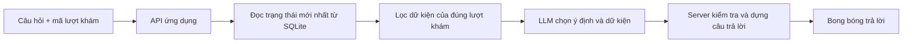

# Ngữ cảnh cho chatbot hướng dẫn thủ tục

Chatbot đã dùng `POST /api/assistant`. Giao diện hội thoại và nguồn dữ liệu được tách riêng: khi đổi nhà cung cấp LLM, giao diện vẫn dùng cùng API của ứng dụng.

## Luồng đang có trong prototype

1. Client gửi `visitId`, câu hỏi, `runId`, revision và ý định của câu trả lời trước. Client không tự gửi hồ sơ hoặc toàn bộ dữ liệu màn hình làm nguồn sự thật.
2. [app.ts](src/server/app.ts) gọi [Repository.read()](src/server/repository.ts) để đọc trạng thái hiện hành trong SQLite. Prototype lưu trạng thái lượt khám dưới dạng JSON trong bảng `state`; khi thay bằng HIS/DB thực, thay lớp Repository bằng các truy vấn đã giới hạn theo phiên đăng nhập / lượt khám.
3. [buildFacts()](src/server/ai/assistant.ts) chỉ lấy lượt đang hỏi, rồi dựng các facts từ state engine, trạng thái thủ tục và sơ đồ.
4. LLM nhận câu hỏi và các facts này. Hiện LLM chọn ý định cùng fact IDs; server kiểm tra các IDs có hợp lệ với ý định không rồi ghép nội dung đã xác định. LLM không tự chạy SQL hay cập nhật tiến độ khám.
5. Server và client kiểm tra lại revision. Nếu lượt khám thay đổi trong lúc chờ, người dùng được yêu cầu hỏi lại để tránh hướng dẫn bằng dữ liệu cũ.

## Nên nạp những dữ liệu gì?

| Nhóm | Nội dung | Nguồn hiện tại |
| --- | --- | --- |
| Bước tiếp theo | Cần làm gì, phòng nào, khi nào chờ bác sĩ | `deriveNextAction()` từ lượt khám trong DB |
| Thủ tục | Chỉ định, thủ tục đã làm / còn lại, cách xếp giấy hoặc lấy số | `Visit.services`, cấu hình cửa phòng trong DB |
| Kết quả | Đã có bao nhiêu kết quả, cách nhận bản giấy / điện tử | Trạng thái dịch vụ và mode của lượt khám |
| Đường đi | Vị trí hiện tại, phòng đến, loại thang và các mốc | Vị trí trong DB kết hợp đồ thị sơ đồ |
| Quy tắc hỗ trợ | Khi mất kết nối, nhờ ai hỗ trợ | Nội dung hướng dẫn được quản lý trong ứng dụng |

Không cần gửi cả DB vào prompt. Với dữ liệu có cấu trúc như trên, truy vấn theo lượt khám rồi đưa một tập dữ kiện ngắn vào mỗi request là đủ cho prototype. Đây là lựa chọn thiết kế cho ứng dụng này, phù hợp với cách đưa thông tin liên quan vào ngữ cảnh trong [OpenAI Docs](https://developers.openai.com/api/docs/guides/prompt-engineering).

Tên, tuổi, nội dung kết quả xét nghiệm và lịch sử khám không được đưa vào facts hiện tại. Chatbot chỉ hỗ trợ thủ tục; hướng dẫn tiến độ và quyết định chuyển bước vẫn do ứng dụng xác định.

## Khi mở rộng sang dữ liệu thủ tục thực

Giữ hai nguồn tách biệt:

- **Dữ liệu động:** trạng thái lượt khám, phòng hiện tại, chỉ định, kết quả đã công bố. Đọc DB lại ở mỗi câu hỏi.
- **Hướng dẫn thủ tục:** giấy tờ cần mang, cách lấy số, địa điểm, giờ tiếp nhận và đầu mối hỗ trợ. Có thể lưu bảng `procedure_guides` với `service_id`, nội dung, phiên bản, người duyệt và thời điểm cập nhật; lấy đúng hướng dẫn cho các thủ tục liên quan.

Khi có nhiều tài liệu dài, bổ sung tìm kiếm tài liệu để lấy đoạn liên quan trước khi gọi LLM. Với số thủ tục hiện tại, truy vấn DB theo mã dịch vụ đơn giản hơn. Thiếu dữ kiện thì trả lời chưa có thông tin và hướng dẫn hỏi bộ phận phù hợp.

## Hội thoại và cấu hình API

- Hội thoại và bản nháp được giữ trong bộ nhớ khi đổi tab; đổi người bệnh, reset hành trình hoặc tải lại trang sẽ tạo hội thoại mới.
- API hiện gửi `previousIntent`, chưa gửi toàn bộ lịch sử bong bóng. Nếu cần hiểu các câu tiếp nối phức tạp, bổ sung một số lượt hội thoại gần nhất và tóm tắt ngắn; dữ kiện tiến độ vẫn phải đọc lại từ DB.
- Provider đã có sẵn trong `ResponsesProvider`; cấu hình `OPENAI_API_KEY` và `AI_MODEL` ở `.env` phía server. Không đưa khóa vào frontend.
- Chưa cấu hình hoặc provider lỗi thì phản hồi mang nhãn hướng dẫn theo tiến độ lượt khám. Kiểm thử UI dùng response giả lập để xác minh gửi / chờ / thử lại; cần chạy `npm.cmd run eval:ai` với cấu hình thực để đánh giá khả năng hiểu câu hỏi của LLM.
