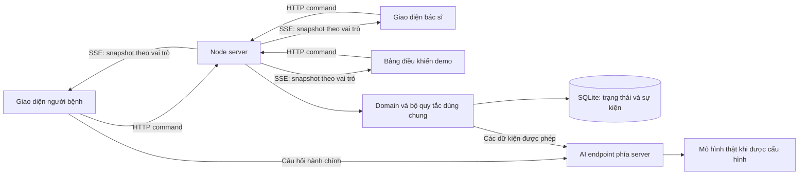

# Kế hoạch thực hiện prototype và phân công multi-agent

Ngày 19/10/2026, giờ Việt Nam. Trạng thái: **đã thực thi code và đóng review R1–R4; AI LIVE và thử người dùng còn thiếu**. Executor A/B và vòng sửa dùng GPT-6.1 Sol; GPT-6 Astra phản biện/rà code. File giữ kế hoạch thiết kế; [báo cáo bàn giao](implementation-report.md), [test report](test-report.md) và [review log](review-log.md) ghi bằng chứng thực tế.

Nguồn yêu cầu: [need statement](../03-need-statement/need-statement.md), [journey và điểm đau](../02-journey-map/journey-map.md), [experiment brief](experiment-brief.md), [simulation spec](simulation-spec.md), [cấu hình mô phỏng](data/simulation-config.json). Bản cuối có 75 tests/typecheck/build pass, audit 0; 8 E2E pass trước feedback modal cuối, chưa chạy browser lại sau sửa nhỏ. Các mục “dự kiến” bên dưới là quyết định khi lập plan, không tự là bằng chứng đã thực hiện.

**1. Kết quả cần bàn giao**

Một web prototype chạy được trên Windows, có giao diện người bệnh theo bố cục app trên điện thoại: nội dung vừa màn hình 360/390 px, vùng chạm lớn, thanh điều hướng dưới và việc tiếp theo nổi bật. Bản trình diễn trên máy tính giữ khung điện thoại cho vai trò bệnh nhân; giao diện bác sĩ và bảng điều khiển dùng bố cục máy tính. Đây là web prototype, không phải gói cài native. Có thể mở ba tab cùng lúc để thấy cập nhật đồng bộ. Có hai chế độ bắt buộc cho cả lượt, sơ đồ dựng với tuyến đường, hỏi đáp AI thật khi được cấu hình, giấy hướng dẫn có thể in và bằng chứng kiểm tra.

Bối cảnh: khám Nội tại Vinmec ở Vinhomes Ocean Park 2; Siêu âm ổ bụng và Xét nghiệm sinh hóa máu. Các phòng/tầng, người bệnh, kết quả và lịch sử đều tự tạo. Không kết nối bệnh viện hoặc đưa dữ liệu sức khỏe thật vào ứng dụng/API.

| Bắt buộc ở bản đầu | Giới hạn rõ của bản đầu |
| --- | --- |
| Đi từ quầy -> phòng Nội -> hai dịch vụ -> kết quả/nhận giấy -> quay lại -> sẵn sàng -> bác sĩ gọi | Không thêm đặt/hủy lịch, thanh toán, thuốc, tái khám hoặc workflow chỉ định động |
| RETURN_TO_DOCTOR và COLLECT_PAPER cho toàn lượt | Không trộn chế độ theo dịch vụ; đổi chế độ tạo/reset lượt |
| Bệnh nhân nhận thông báo, bác sĩ cập nhật nền | Inbox/thông báo trong app khi tab đang kết nối; không tuyên bố đã có push khi đóng app |
| Sơ đồ có tòa/tầng/phòng, mốc, đường đi và hướng dẫn chữ | Sơ đồ giả, vị trí do người dùng xác nhận; không GPS/QR xác thực hiện diện |
| Hai cột bác sĩ và mở đúng kết quả/lịch sử giả khi gọi | Vai trò mô phỏng chạy local, chưa có tài khoản hay phân quyền bệnh viện thật |
| Có AI hiểu câu hỏi hành chính dựa trên dữ liệu hiện tại | AI không chẩn đoán, đổi chỉ định, xác nhận kết quả, điều phối lượt hoặc tự sửa trạng thái |
| Giấy hướng dẫn, báo lỗi rõ và thao tác sẵn sàng thủ công | Toàn server ngừng hoạt động thì giấy/nhân viên là đường tiếp tục; không hứa backend vẫn đồng bộ |

Thông báo hệ điều hành khi tab ở nền chỉ xem xét sau nghiệm thu v1 nếu cơ chế/quyền trình duyệt cho phép; không là phụ thuộc của inbox hoặc phép thử chính. Web Push khi đóng ứng dụng và app native không thuộc mốc hoàn tất bản đầu.

**2. Phân vai model và nguyên tắc giao việc**

| Vai trò | Model phân công | Phần việc | Hiện trạng |
| --- | --- | --- | --- |
| Lập kế hoạch/phản biện | gpt-6-astra, reasoning high | Kiến trúc, trạng thái, ranh giới module, ca lỗi, rà kế hoạch | Đã dùng một agent đọc nguồn và phản biện |
| Executor A | gpt-6.1-sol, reasoning high | Scaffold/hợp đồng, domain, backend, lưu trữ, đồng bộ; sau đó AI server và kiểm thử tương ứng | Đã khởi chạy thực thi |
| Executor B | gpt-6.1-sol, reasoning high | Giao diện ba vai trò, bản đồ, in giấy, trạng thái kết nối; kiểm thử giao diện và E2E | Đã khởi chạy; ưu tiên giao diện bệnh nhân trên điện thoại |
| Rà code sau triển khai | gpt-6-astra, reasoning high hoặc xhigh | Đọc source/test, truy SIM-01–11, tìm lỗi logic/concurrency/AI, kiểm tra bằng chứng | Chỉ bắt đầu khi có bản ghép và kết quả kiểm tra |
| Điều phối | Agent chính | Quản lý hợp đồng/tích hợp, theo dõi phụ thuộc, đọc kết quả kiểm tra và giao sửa; giữ đúng phạm vi | Không cho nhiều agent sửa cùng file |

Hai executor dùng GPT-6.1 Sol theo yêu cầu cập nhật để viết toàn bộ code, kể cả tests và phần AI. Model lớn viết quyết định thiết kế/phản biện, không tự nhận hết phần code. Nếu executor bị kẹt, model lớn phân tích vấn đề và giao lại bản sửa cụ thể. Model trong prototype được cấu hình riêng qua AI_MODEL; không mặc định tên model agent Codex là model API mà tài khoản sử dụng được.

Chỉ dùng subagent của chat hiện tại, không tạo chat mới. Trong giai đoạn code có tối đa hai executor viết song song; đủ trong giới hạn bốn agent hoạt động kể cả điều phối. Khi rà cuối, dừng viết ở bản được review; sau đó giao sửa có phạm vi và kiểm tra lại phần bị ảnh hưởng.

**3. Kiến trúc dự kiến và kiểm tra môi trường đã làm**

Stack dự kiến: React + TypeScript + Vite ở frontend; Node.js + TypeScript + Express ở server; SQLite qua node:sqlite; HTTP command để ghi và Server-Sent Events (SSE) để cập nhật màn hình. Vitest kiểm tra domain/server; Playwright kiểm tra luồng nhiều trang trên trình duyệt.

Khi chọn stack đã kiểm tra Node v24.11.1 và SQLite in-memory, ghi nhận cảnh báo experimental. Sau triển khai đã cài/pin dependency, kiểm tra DB file/transaction/restart và Chrome E2E; Vitest đã nâng riêng lên 5.0.5 sau audit. Node engines hiện cho 24.x từ 24.11.1 hoặc 26+; môi trường đã kiểm tra là 24.11.1. Kết nối model thật chưa hoàn tất. Không dùng Docker hoặc Python backend trong bản này.



Server là nguồn trạng thái chuẩn. Không dùng localStorage/BroadcastChannel làm cơ sở chia sẻ trạng thái ba vai trò. Local storage nếu có chỉ giữ lựa chọn giao diện không ảnh hưởng nghiệp vụ. Bản build được server phục vụ cùng origin; dev dùng Vite proxy cho /api. Mặc định bind loopback để trình diễn trên một máy.

Mỗi trang dùng một kết nối SSE. Khi kết nối/reconnect, server đăng ký subscriber trước rồi gửi snapshot hiện tại với thứ tự được bảo đảm; cập nhật trong lúc khởi tạo được giữ/gửi tiếp theo revision. Không làm GET snapshot rồi mới subscribe mà thiếu cơ chế bù khoảng trống. Dùng một tiến trình server trong v1; publish chỉ sau commit. UI bỏ bản cũ theo runId/revision, hiển thị mất kết nối và lần cập nhật. Không cần replay lịch sử phức tạp; event log vẫn lưu để kiểm tra. Đổi run xóa ngữ cảnh UI/AI cũ và kết nối tới run hiện hành.

**4. Hợp đồng dữ liệu phải chốt trước khi hai agent code song song**

| Đối tượng | Nội dung tối thiểu |
| --- | --- |
| SimulationRun | runId, generation tăng bền qua reset, revision, mode, seed, các lượt khám, activeEncounter, createdAt |
| Visit | visitId giả, phase khám đầu/làm dịch vụ/quay lại, hai service, vị trí tự xác nhận, readiness, inbox, history giả |
| Service | id/locationId, executionStatus, performanceOrder, resultStatus, resultConfirmedAt, paperStatus |
| DoctorWorkspace | activeEncounter; hai danh sách được suy ra từ trạng thái lượt, không thêm/xóa độc lập |
| Location/Graph | node ID, tòa/tầng mô phỏng, tọa độ để vẽ, lối nối/đổi tầng, trọng số và mốc chỉ dẫn |
| Command | commandId, runId, visitId nếu cần, expectedRevision, actor mô phỏng, type, payload |
| Snapshot | runId, revision, trạng thái được chiếu theo vai trò, việc tiếp theo/điều kiện/tuyến đã tính |
| CommandReceipt | commandId, request hash, kết quả xác nhận và revision; giúp gửi lại không lặp tác động |
| AiContext/Answer | dữ kiện hành chính đã lọc, fact IDs, context revision, intent/schema, nguồn live/fallback |

Các ID phòng dựng ban đầu dùng DEMO-NOI, DEMO-SIEUAM, DEMO-SINHHOA và bổ sung quầy/cổng/đổi tầng. Không suy tầng từ số phòng hoặc gán tọa độ giả thành thông tin thật. Dataset tối thiểu có ba người bệnh giả để kiểm tra kết quả người A cập nhật khi bác sĩ đang xem người B.

Domain cung cấp applyCommand, deriveNextAction, deriveQueues và deriveRoute. Ba màn hình và phần AI cùng dùng kết quả domain; frontend không viết lại luật đủ kết quả, đủ giấy hoặc hàng chờ. Hợp đồng ghi thành type/schema và fixtures nhỏ, model lớn rà rồi mới mở hai nhánh thực thi song song.

**5. Quy tắc trạng thái và xử lý thao tác đồng thời**

1. Chế độ bất biến trong run/lượt. Reset tạo runId mới và tăng generation trong transaction; client từ chối generation thấp, cùng generation khác runId và revision cũ. Đây là bổ sung từ R1 để chặn ACK/SSE của run trung gian chưa từng thấy. Command cũ bị từ chối, selection/vị trí/inbox/hội thoại không lọt sang run mới.
2. Dịch vụ chỉ có kết quả khi đã hoàn tất thao tác. Demo thực hiện tuần tự, tối đa một dịch vụ đang thực hiện trong một lượt. performanceOrder cấp khi xác nhận START; kịch bản có thể đổi việc nào bắt đầu trước. Đây là quyết định kỹ thuật để làm rõ “làm trước”, không phải trình tự y khoa.
3. Kết quả theo performanceOrder, chỉ do bộ phận dịch vụ xác nhận; không do hết ETA hoặc bệnh nhân bấm. Công bố kết quả thứ hai trước thứ nhất bị chặn trong demo.
4. Paper collected chỉ hợp lệ ở COLLECT_PAPER, khi hai dịch vụ đã thực hiện xong và kết quả tương ứng đã có. Sau đó hướng nhận nơi đã có kết quả trước trong các bản chưa nhận; không ưu tiên nhận giấy khi còn đang thực hiện dịch vụ.
5. canReturn suy ra: xong cả hai + đủ hai kết quả + đủ giấy nếu cần. Không có cờ canReturn độc lập mà UI tự sửa. Quy tắc này là giả định demo được người làm bài chọn.
6. Đủ kết quả không tự thành ready. Ready cần canReturn và tự xác nhận có mặt ngoài phòng. Manual ready của nhân viên dùng cùng gate, khác actor/source. Nút không chứng minh vị trí vật lý.
7. Hai queue suy ra từ visit phase; không có một lượt nằm cả hai cột. Một bác sĩ có tối đa một activeEncounter. Bác sĩ chọn người gọi; không tự lập ưu tiên giữa hai cột. Thao tác gọi chuyển khỏi hàng chờ và tự mở đúng bộ kết quả/history giả.
8. Kết quả người khác cập nhật không thay activeEncounter hoặc tự đổi hồ sơ đang xem. Một xác nhận tạo một notification logic; không nhân đôi do retry.
9. Mọi ghi thực hiện trong một transaction: kiểm tra active run/command cũ/revision/điều kiện, cập nhật snapshot, ghi event và receipt. Gửi lại cùng commandId/payload trả kết quả đã xử lý; cùng ID khác payload bị từ chối. Snapshot phản hồi không làm UI quay về revision cũ.
10. Hai click khác commandId vẫn phải idempotent theo nghiệp vụ: không tạo hai hàng ready, hai lần nhận cùng giấy hoặc hai lời gọi. Lệnh lỗi thời trả conflict kèm snapshot mới; không tự phát lại hành động nguy hiểm trên trạng thái mới.
11. CALL và WITHDRAW_READY cạnh tranh được xử lý tuần tự/nguyên tử. Hành động thành công trước quyết định trạng thái; thao tác sau bị chặn nếu không còn hợp lệ. Không tự hủy cuộc tiếp nhận sau khi bác sĩ đã gọi.
12. UI có pending/confirmed/failed/unknown. Nếu mất phản hồi sau khi server nhận, chưa kết luận thất bại: đọc snapshot hoặc gửi lại cùng commandId. Chỉ hiển thị đã sẵn sàng/đã được gọi sau xác nhận.

Reset cũng là một thao tác có commandId, expectedRunId/expectedRevision và receipt. Receipt reset lưu ngoài trạng thái bị reset, cùng transaction tạo run mới. Retry cùng ID/payload trả run đã tạo và snapshot hiện hành, không reset thêm hoặc xóa tiến độ mới; ID cũ khác payload bị từ chối. Reset mới từ tab có expectedRunId lỗi thời trả conflict. Hai reset đồng thời và mất ACK phải có test riêng.

Vòng đời bác sĩ: CALL_INITIAL chỉ hợp lệ khi chưa có activeEncounter, tạo lượt initial ở trạng thái đã gọi; BEGIN_ENCOUNTER xác nhận bắt đầu trao đổi. ASSIGN_DEMO_SERVICES chỉ áp dụng cho đúng lượt initial đang tiếp nhận, chuyển người bệnh làm dịch vụ và giải phóng bác sĩ trong cùng transaction. CALL_REVIEW cần người ready và bác sĩ đang trống, tạo lượt review và mở bộ kết quả; BEGIN_ENCOUNTER đánh dấu đang trao đổi, COMPLETE_ENCOUNTER kết thúc review/giải phóng bác sĩ. Không gọi người khác khi đang bận; UI hướng hoàn tất lượt hiện tại. Các timestamp gọi/bắt đầu/kết thúc được giữ để không gộp trạng thái.

Cụ thể hóa thêm hai hành động nhỏ: “Tôi bắt đầu quay lại” để không suy người bệnh đang di chuyển từ thông báo; “Tôi đã rời khu chờ” để rút ready trước khi được gọi. Kết thúc demo bằng bác sĩ xác nhận đang trao đổi/hoàn tất, không thêm chẩn đoán thật hoặc đơn thuốc.

**6. Hợp đồng API dự kiến**

| Endpoint | Mục đích và điều kiện |
| --- | --- |
| GET /api/health | Server và khả năng dữ liệu sẵn sàng; không trả key |
| GET /api/snapshot | Snapshot theo vai trò/visit được chọn trong demo |
| GET /api/events | SSE theo vai trò; gửi snapshot mới và trạng thái reset |
| POST /api/commands | Validate schema/actor/active run/revision/gate; transaction và receipt |
| POST /api/demo/reset | Tạo run mới với chế độ/seed rõ; commandId/expectedRunId/revision, receipt bền qua reset và retry an toàn; chỉ bảng điều khiển mô phỏng |
| POST /api/assistant | Hỏi đáp chỉ đọc; server tự lấy context hiện tại, không nhận trạng thái tùy ý từ client |

Các command chính: REGISTER, CALL_INITIAL, BEGIN_ENCOUNTER, ASSIGN_DEMO_SERVICES, START_SERVICE, COMPLETE_SERVICE, CONFIRM_RESULT, COLLECT_PAPER, CONFIRM_LOCATION, START_RETURN, MARK_READY, STAFF_MARK_READY, WITHDRAW_READY, CALL_REVIEW, COMPLETE_ENCOUNTER, MARK_NOTIFICATION_READ. Reset có endpoint/receipt riêng nhưng cùng nguyên tắc kiểm tra. Không mở API tùy ý để sửa cả object lượt khám.

Role trong bản local là lựa chọn mô phỏng, không được gọi là xác thực bệnh viện. Route server vẫn giới hạn loại hành động theo vai trò để tránh UI gửi nhầm. Trước khi đưa lên host phải xử lý quyền truy cập doctor/control, storage bền và cấu hình secret; không mặc định công khai ba giao diện.

**7. Thiết kế ba giao diện**

| Giao diện | Nội dung và hành vi bắt buộc |
| --- | --- |
| Người bệnh | Header nhãn demo/cơ sở; thẻ việc bây giờ; hai dịch vụ và trạng thái riêng thao tác/kết quả/giấy; nút mở nội dung kết quả giả ngay khi từng kết quả được công bố trong cả hai chế độ, không đợi nhận giấy/bác sĩ gọi; xem đường và mốc; inbox/thông báo; hỏi AI; xác nhận điểm đầu/ngoài viện; quay lại/sẵn sàng; lối dùng giấy và hỏi nhân viên |
| Bác sĩ | Hai cột chính, người đang tiếp nhận, chọn gọi lần đầu hoặc review; xác nhận hai dịch vụ giả; bộ kết quả/lịch sử chỉ tự mở khi gọi; kết quả mới của người khác không chiếm màn hình |
| Điều khiển mô phỏng | Chọn/reset run theo chế độ; chọn lượt; xác nhận các sự kiện ở quầy/dịch vụ; giao giấy; kịch bản theo bước; mô phỏng lỗi riêng màn người bệnh; đăng ký ready thủ công đúng gate; event log dễ kiểm tra |

Giao diện ưu tiên tiếng Việt, chữ rõ, nhãn chữ/biểu tượng đi cùng màu. Hướng dẫn trong sản phẩm dùng ngôn ngữ người bệnh, không hiển thị tên API, revision hay chi tiết kỹ thuật. Kỹ thuật/event log chỉ nằm bảng điều khiển demo. Thiết kế responsive cho điện thoại khoảng 390 px, tablet và desktop; có hướng dẫn đường bằng chữ để người không đọc được sơ đồ vẫn dùng được.

SVG map và tuyến dùng cùng graph với domain. Tuyến không xuyên tường/nhảy tầng; có lối đổi tầng và điểm xuất phát đã xác nhận. Nếu đang ngoài viện, hỏi chọn mốc xuất phát, không coi phòng dịch vụ trước là vị trí thực. Chưa tối ưu thứ tự tổng lượt; quy tắc nhận kết quả trước vẫn giữ.

Giấy hướng dẫn là màn HTML/CSS print có cơ sở/phòng giả, hai việc, điểm quay lại và đầu mối là quầy/nhân viên mô phỏng; không bịa số điện thoại thật. In/lưu do trình duyệt phục vụ, không cần làm hệ xuất PDF riêng.

**8. AI thật: phạm vi, kết nối và bằng chứng**

AI giải quyết việc hiểu câu hỏi hành chính đa dạng và chọn đúng thông tin từ tiến độ hiện tại. Những câu cần hỗ trợ: “Giờ tôi làm gì?”, “Kết quả có rồi sao tôi chưa được vào?”, “Tôi có phải lấy giấy không?”, “Tôi đang ngoài viện thì đi về đâu?”, kể cả diễn đạt không dấu hoặc hỏi nối tiếp ngắn.

Luồng dự kiến: câu hỏi -> server lấy snapshot/facts/route hiện tại -> mô hình xác định intent và chọn fact IDs trong schema cho phép -> server kiểm tra các ID/ngữ cảnh -> dựng câu trả lời từ dữ kiện chuẩn và dẫn tới thẻ hướng dẫn/tuyến. Bản đầu ưu tiên cách này để không cho mô hình tự đặt phòng, kết quả hoặc quyền đi tiếp. Nếu thêm diễn giải tự do, đó là cải tiến sau kiểm tra riêng, không thay dữ kiện và hành động chuẩn.

Context chỉ gồm trạng thái hành chính hiện tại, chế độ, điều kiện, mốc/tuyến và hướng dẫn đã cấp. Không cần gửi giá trị xét nghiệm hoặc lịch sử sức khỏe cho mô hình; bác sĩ vẫn xem lịch sử giả ở giao diện của mình. AI không có tool ghi/đổi trạng thái. Câu hỏi chuyên môn, dữ liệu thiếu hoặc không liên quan được chuyển sang hướng dẫn hỗ trợ phù hợp.

Kết nối dự kiến qua adapter server với Responses API và output JSON theo schema. AI_MODEL là model ID được tài khoản cho phép và hỗ trợ schema, xác nhận bằng smoke test khi thực thi; không gán từ tên agent. API key nằm cấu hình server, không frontend/repo/chat. Trước tích hợp dùng luồng openai-platform-api-key nếu khả dụng; nếu không có, người dùng cấu hình secret riêng. Không tạo/rotate key chỉ để khảo sát và không gọi mô hình trong lượt lập kế hoạch này.

Structured output chỉ giúp cấu trúc dữ liệu, không chứng minh diễn giải đúng. Server kiểm tra fact IDs tồn tại, thuộc context hiện tại và được phép dùng cho intent tương ứng; không chỉ chấp nhận một fact có thật nhưng không trả lời đúng câu hỏi. Kiểm tra thêm context revision. Khi trạng thái/run đổi trong lúc chờ AI, không hiển thị câu trả lời cũ như hiện hành; hướng dẫn chuẩn vẫn sẵn, yêu cầu hỏi lại hoặc cập nhật một lần có giới hạn. Có xử lý timeout/refusal/incomplete/lỗi mạng, không retry vô hạn.

Có hai trạng thái được ghi đúng: LIVE là có request/response thật hợp lệ; FALLBACK là hướng dẫn hệ thống khi AI chưa kết nối/lỗi. Câu trả lời viết sẵn không được gắn nhãn AI thật. Không cần chờ key để dựng UI/domain, nhưng chưa hoàn tất yêu cầu AI khi chưa chạy live.

Bộ đánh giá dự kiến 24 trường hợp: 8 về bước tiếp/vị trí, 6 về kết quả/giấy, 4 về sẵn sàng/gọi vào, 6 ngoài phạm vi hoặc cố yêu cầu đổi quy tắc. Lưu tình trạng đầu vào, prompt version, model phản hồi thực tế, source live/fallback, đầu ra, đúng/sai và lỗi. Ưu tiên kiểm tra các trường hợp có kết quả chưa đủ, thiếu giấy, đang ngoài viện, reset khi pending. Không tuyên bố bộ câu hỏi hữu hạn đảm bảo mọi câu tương lai đều đúng.

**9. Thư mục và quyền sở hữu khi code**

Các đường dẫn sau là dự kiến bên trong 05-prototype, chưa phải file ứng dụng đã có:

```text
package.json / package-lock.json / tsconfig*.json / vite.config.ts
.env.example
src/
  shared/       types, schemas, command/event contract
  domain/       transitions, next action, queues, routing
  server/       HTTP/SSE, transaction service, repository
    ai/         provider adapter, context builder, answer renderer
  client/       patient, doctor, control, map, inbox, AI panel, print
data/
  simulation-config.json          đã có, nguồn cấu hình hiện hành
  mock-hospital.json             sẽ dựng graph/sơ đồ
  mock-visits.json               sẽ dựng ba người giả và history
  ai-evaluation-cases.json       sẽ dựng trường hợp kiểm tra
tests/
  domain/ server/ ai/ client/ e2e/
.prototype-runtime/              DB/log tạm, phải ignore
```

Executor A sở hữu package/lock/build config, shared, domain, server, data, tests/domain/server/ai. Executor B sở hữu client/assets, tests/client/e2e. Không cho B cài dependency hoặc sửa package/shared/data trực tiếp; gửi đề xuất dependency/contract cho A và điều phối. Mock transport của B chỉ phát fixture đúng contract, không chứa một bộ quy tắc nghiệp vụ thứ hai. Bỏ/mock giới hạn về chế độ phát triển sau khi ghép server thật, không dùng làm đường demo mặc định.

**10. Các chặng thực hiện và điều kiện chuyển chặng**

| Chặng | Việc và người thực hiện | Sản phẩm kiểm tra được | Điều kiện qua |
| --- | --- | --- | --- |
| P0 - Setup và hợp đồng | Astra/điều phối chốt plan; Sol A scaffold, schemas, fixtures, scripts; kiểm tra dependency/runtime/AI access | App tối thiểu mở được, schema config, API contract, install/build scripts | Runtime/build chạy; hợp đồng đủ cho A/B; không có key trong source |
| P1A - Domain/backend | Sol A làm reducer/selectors, SQLite transaction, commands, snapshot/SSE, reset | Domain/server tests và API dùng được | Hai mode × hai thứ tự, gate/queue/idempotency/reset đúng |
| P1B - UI/bản đồ | Sol B song song sau P0, dùng fixture transport | Ba màn, map/text, giấy in, inbox, trạng thái lỗi | Luồng nhìn và thao tác được; không tự viết lại domain; responsive |
| P2 - Ghép luồng | A hoàn thiện API/SSE và xử lý lỗi server; B nối client transport thật, sửa binding/UI và thêm E2E | Ba tab thay đổi đồng bộ từ một trạng thái chuẩn | Đi hết hai chế độ, reload/reconnect không lệch; SIM quan trọng đạt |
| P3 - AI thật | A làm adapter/context/schema/renderer/eval; B nối AI panel và fallback | LIVE hoạt động với đầu vào giả, log model/prompt/đầu ra | Có request thật kiểm chứng; không dùng model thay quyết định nghiệp vụ |
| P4 - Kiểm tra và rà code | A/B chạy test đúng phạm vi; dừng sửa; Astra rà độc lập | Review log có file/dòng/tác động/cách tái hiện và kết quả kiểm tra | Không còn lỗi P0/P1 hoặc vi phạm yêu cầu bắt buộc; sửa do Sol A/B thực hiện và kiểm tra lại |
| P5 - Thử người dùng | Người làm bài mời 2–3 người; agent chuẩn bị bản/nhiệm vụ và ghi dữ liệu được cung cấp | Log thật, vấn đề quan sát và bản sửa có căn cứ | Không bịa người/lời nói/số liệu; biết hạn chế mẫu |
| P6 - Đóng gói | Điều phối cập nhật README/prompt/changelog/cách chạy; Astra rà bằng chứng | Source/lock/env example/demo guide, test report, review log, ảnh minh họa | Máy người chấm chạy được theo README; khai báo AI rõ, key/DB/log riêng không lọt repo |

P1A/P1B chạy song song; P3 có thể bắt đầu ngay khi context contract ổn, song không thay việc hoàn tất P2. Việc chuẩn bị kết nối AI và mời người thử nên làm sớm từ P0 để không chờ cuối. Không trì hoãn toàn bộ triển khai vì thiếu key; chỉ đánh dấu P3-live chưa đạt.

Ưu tiên cùng ngày theo hạn bài 19/10: trước hết có luồng xuyên suốt cả hai chế độ và AI thật; sau đó review, thử người và sửa, rồi mới trang trí/ảnh. Không hứa thời điểm hoàn tất khi chưa có dependency, kết nối AI và người thử. Nếu phải giảm phạm vi, bỏ cải tiến tùy chọn như system notification/animation; không bỏ một chế độ, nút ready, bác sĩ hai cột, giấy dự phòng hoặc khai báo AI.

**11. Danh sách kiểm tra bắt buộc và bằng chứng**

| Nhóm | Trường hợp cần kiểm tra | Bằng chứng dự kiến |
| --- | --- | --- |
| SIM-01–04 | Cả lượt cùng chế độ; thao tác xong chưa tự có kết quả; thông báo/cập nhật nền; thứ tự thực hiện/kết quả | Domain table tests + server integration |
| Quyền xem kết quả | Trong mỗi chế độ, bệnh nhân mở đúng nội dung giả của từng kết quả ngay sau công bố, trước nhận giấy hoặc bác sĩ gọi; chưa công bố thì chưa mở được | Server integration + một bước E2E cho mỗi chế độ |
| SIM-05–07 | Thiếu kết quả chưa quay lại; điện tử rời viện và xác nhận lại điểm đầu; giấy nhận đúng nơi trước/đủ hai bản | E2E hai chế độ, cả hai thứ tự trong engine |
| SIM-08–09 | Ready đúng gate, không nhân đôi; hai cột đúng; bác sĩ không bị ngắt và mở đúng người khi gọi | E2E nhiều trang, ít nhất ba người giả |
| SIM-10–11 | Màn bệnh nhân mất kết nối, giấy/nhân viên tiếp tục; reset sạch mode/queue/inbox | Server integration + E2E lỗi/reconnect/reset |
| Concurrency | Hai click khác ID; retry cùng ID; cùng ID khác payload; mất ACK; CALL/WITHDRAW; patient/staff ready; hai lần gọi khác người; hai reset đồng thời và retry reset không tạo run nữa | Tests có transaction/HTTP thật, không chỉ test hàm stub |
| Chống dữ liệu cũ | Command/SSE/AI tới sau reset hoặc sau revision đổi; reload và reconnect | Integration/E2E điều khiển thứ tự phản hồi |
| Khởi tạo và bền dữ liệu | Command xảy ra đúng lúc SSE connect/reconnect vẫn tới revision mới nhất; restart server vẫn giữ active run, lượt/giấy/queue/inbox đúng từ SQLite | Server integration + E2E reconnect; restart bằng DB tạm |
| Map/UI | Đúng tuyến cùng graph, đổi tầng, ngoài viện không lấy vị trí cũ; mobile/desktop, keyboard, nhãn không chỉ màu | Kiểm tra hành vi + ảnh ở kích thước đại diện |
| AI | Intent/facts phù hợp trạng thái; không có quyền ghi; lỗi model và fallback có nhãn; LIVE có log thật | Bộ ca giả và báo cáo từng ca, không điền trước kết quả |
| Giấy | In được, có điểm đến/quay lại/hỗ trợ; nhánh điện tử vẫn có giấy hướng dẫn | Kiểm tra print view; phân biệt giấy hướng dẫn và bản kết quả |

Không viết snapshot test cả trang hoặc test từng class CSS. Unit tests tập trung điều kiện nghiệp vụ; integration dùng SQLite tạm; E2E chứng minh các màn thực sự đồng bộ. Không dùng click qua UI của một người duy nhất để xác nhận yêu cầu nhiều bệnh nhân.

Các script dự kiến sau setup: npm run dev, npm run typecheck, npm test, npm run test:e2e, npm run build, npm start. Chỉ báo script đã pass khi thực sự chạy trên source hiện hành. Chưa cài browser thì ghi rõ E2E chưa chạy; không thay bằng tuyên bố đã kiểm tra trình duyệt. Không thêm vòng test rộng lặp lại sau khi đã pass nếu không có thay đổi/lỗi/rủi ro mới.

**12. Cách review của model lớn và vòng sửa**

Model lớn nhận source, contract, đặc tả, test output và danh sách giới hạn tại một snapshot ổn định. Đọc cả code mới và cách ba phần ghép nhau, đặc biệt gate giấy/kết quả, activeEncounter, stale run, transaction/idempotency, client thông báo thành công, AI context và lối dự phòng. Không chỉ dựa vào báo cáo của executor hoặc kiểm tra bề ngoài.

Mỗi finding có mức P0/P1/P2, file/dòng, điều kiện tái hiện, tác động người dùng và yêu cầu kiểm tra sau sửa. Không đề xuất thêm scope chưa yêu cầu. Điều phối giao đúng executor sở hữu file để sửa; bản sửa có test tái hiện lỗi khi phù hợp. Sau sửa, model lớn rà lại phần thay đổi và rủi ro tích hợp liên quan. Không tự coi reviewer là người dùng thật hoặc tạo log test người dùng từ review code.

**13. Thông tin còn thiếu và cách tiếp tục**

Không cần thêm thông tin nghiệp vụ, bản đồ thật, dữ liệu người bệnh, RAG/vector database hoặc tài khoản bệnh viện để bắt đầu. Các mặc định kỹ thuật ở mục 5 được ghi riêng để không biến thành sự kiện nghiên cứu.

Để chạy AI thật cần một kết nối có quyền dùng: provider/endpoint, model thực tế và credential cấu hình phía server. Đây là phụ thuộc của P3-live, không phải lý do chặn P0–P2. Nếu người làm bài có nguồn AI khác, chỉ thay provider adapter và kiểm tra lại schema/eval; không dựng lại luồng nghiệp vụ. Không xin dán key vào chat.

Để hoàn tất phần thử người cần người làm bài sắp lịch 2–3 người có đồng ý; agent chuẩn bị nhiệm vụ và tổng hợp quan sát thật. Đăng ký/phỏng vấn, nhật ký tự dùng MyVinmec và slides thuộc yêu cầu bài nộp còn lại, không tự được đánh dấu xong chỉ vì prototype chạy.

Mặc định xây và chạy local trước. Chưa tạo Site, host, remote repo, triển khai công khai hoặc gửi email trong lượt lập kế hoạch. Nếu sau này cần URL chia sẻ, chọn môi trường có backend/storage phù hợp và quyền truy cập demo; chuyển sang Sites/Workers cần adapter lưu trữ tương ứng, không tải một frontend tĩnh rồi coi backend Node/SQLite đã được triển khai.

**Nguồn kỹ thuật đã kiểm tra cho quyết định thiết kế**

- [OpenAI Structured Outputs](https://developers.openai.com/api/docs/guides/structured-outputs): tham khảo hợp đồng JSON và các trường hợp refusal/incomplete; các gate nghiệp vụ vẫn do server của prototype quyết định.
- [OpenAI API authentication](https://developers.openai.com/api/reference/overview#authentication): cấu hình key phía server, không client.
- [Node v24.11.1 SQLite](https://nodejs.org/download/release/v24.11.1/docs/api/sqlite.html): tham khảo API lưu trữ; đã kiểm tra in-memory trên runtime hiện có và ghi nhận cảnh báo experimental.
- [Vite](https://vite.dev/guide/), [Vitest](https://vitest.dev/guide/), [Playwright](https://playwright.dev/docs/intro): nguồn chính thức cho setup/build/test; phiên bản dependency cụ thể sẽ pin và kiểm tra ở P0.
- [MDN SSE](https://developer.mozilla.org/en-US/docs/Web/API/Server-sent_events/Using_server-sent_events): cơ chế cập nhật một chiều server → client; thao tác ghi vẫn đi qua HTTP command.
